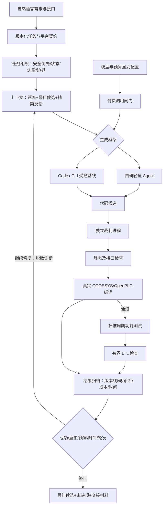

# 成员二技术交接

## 任务边界与完成判据

本岗位负责 Agent 调度、模型交互、上下文管理、工具组织、编译修复、运行测试、平台适配和实验工具。团队总报告、PPT、视频剪辑由其他成员完成，本包提供对应技术材料。

基础任务要求 20 道公共题和至少 10 道自建题；当前整合为 20 公共题与 15 自建题，计划完成两框架乘两模型四组真实实验。用户已确定 DMXAPI 两模型及 75 元预算，详见实验协议和接续开发记录。前期完成状态不等于四组真实模型实验完成。

最终状态以 evidence 中本轮验收数据及验收报告为准。成员一的旧说明文档属于 v1.1 历史资料；其中“全部 LTL hold”“已完成三道闸门”等原结论不得直接当成本版本结果。

## 架构

图源见 architecture.mmd。Agent 与裁判分离；完整 expected、actual、测试说明和参考代码保留在裁判侧。模型只获得题面、接口、规约和脱敏诊断。

1. 输入适配：保留变量方向、结构体字段、扫描周期和规约。无 LTL 消融真正从任务提示中删除规约。
2. 任务组织：明确安全/复位优先级、组合输出与保持状态、边沿、数组和时间单位。
3. 上下文：每轮保留题目、最佳候选、最新失败反馈。旧代码轮次不无限累加。
4. 工具：私有 Python 进程执行接口检查、扫描测试和模型检查；真实编译走独立平台接口。
5. 修复与停止：最多 5 个候选，10 分钟任务上限；重复候选、预算耗尽、网络故障和检查器不可判定各有终止原因。
6. 留痕：每轮保存源码、用量、耗时、诊断和代码哈希；恢复时核验题目、代码版本、模型和限制签名。

## 判定接口

- StageResult.compiles：自研前端及接口契约检查，不表示 CODESYS 编译。
- platform_results：真实平台 passed/failed/timeout/unavailable/tool_error。
- tests_passed/tests_total：完整题目分母，编译失败也贡献该题全部用例。
- LTL：bounded_pass/violated/truncated/timeout/inconclusive/tool_error/not_run。
- solved：测试全过且已要求的平台编译均通过。
- fully_verified：solved 且所要求的有界检查完成；仍不是无限状态正确性证明。

有限域由用例取值推导，不能声称覆盖整个 PLC 数值域。有界展开达到深度界限是界内结论；撞到时间或迁移预算为截断。运行期错误不能被忽略后继续宣称规约通过。

## 现有框架基线

实际运行 Codex CLI，使用其非交互 JSONL 输出、独立临时目录和明确的模型/provider 配置。为控制变量，本实验比较“代码候选生成与共同外部裁判反馈”的受控模式，关闭 shell、web 和模型端工具；不是无限制 Codex 仓库自主开发能力测试。

离线 Responses 服务只在本机回环地址运行，不调用真实模型。真实模式必须经配置校验和预算网关；不得把离线参考代码的通过率当作真实模型质量。

参考：[Codex 非交互模式](https://learn.chatgpt.com/docs/non-interactive-mode)。

## 平台适配边界

原接口和平台适配版分开保存、分开统计。适配版采用已有题库文档约定的扫描周期计数，把 LTIME 累加器表示为 LINT；移位改用 IEC 函数，并补充严格类型所需的显式转换。

原生诊断还发现两个临时变量 s/r 的词法冲突，以及一个泵索引交换临时量的 LINT→INT 窄化问题。适配版重命名这两个内部变量，并让索引临时量使用 INT；接口和原输出断言不变。当前适配契约为 portable-frame-v4，包含 FIFO 固定容量绑定；早期 portable-frame-v2 平台工程仅作历史证据。规则与源码哈希见当前阶段 freeze.json 及正式覆盖调度修复说明。

通用 VARIANT FIFO 另提供 DINT、有限物理容量、显式逻辑容量的特化版本。保留原 27 条输出断言及两种逻辑容量；不宣称证明了任意元素类型和任意容量的原始泛型要求。

OpenPLC Runtime v4 的编译流程在本机完成 STruC++ 检查和 C++/运行时包生成，没有向物理 PLC 上传，不宣称完成实际设备运行。

## 后续接手顺序

1. 运行快速验收，核对冻结哈希及平台版本。
2. 查看验收报告中的未决项与 LTL 不完整范围。
3. 核对已确定的 `config.dmxapi.json`、共享预算账本、接入证据及尚未结算的预留。
4. 小规模真实接口核验通过后，冻结实验配置并完整执行四组 35 题。
5. 根据失败类别改进通用策略，保留开发结果与最终评测的分隔及全部失败记录。

## 2026 年 10 月 30 日更新

新增五道流程工业题并扩展所有实验至 35 题 / 435 条用例。单位、超压连续计数、PI 初始化约定与 dt 输入适配详见二次更新整合说明。原 v2.0 交接包未覆盖。
